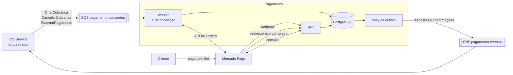

# oficina-mecanica-pagamento

Microsserviço de **Pagamento** do sistema da oficina mecânica (Tech Challenge FIAP, Fase 4): cria a **cobrança no Mercado Pago** depois que o cliente aprova o orçamento, envia o **link de pagamento**, confirma o pagamento e, quando a saga é compensada, **cancela** a cobrança ou **estorna** o pagamento.

É um dos 6 microsserviços do sistema. A divisão, a saga e o contrato entre os serviços estão documentados no repositório principal, [oficina-mecanica-fiap](https://github.com/phantosmia/oficina-mecanica-fiap):

- [RFC-0008: Orçamento e Pagamento como microsserviços separados](https://github.com/phantosmia/oficina-mecanica-fiap/blob/main/docs/rfcs/0008-separacao-orcamento-e-pagamento.md)
- [ADR-0011: Pagamento em PostgreSQL](https://github.com/phantosmia/oficina-mecanica-fiap/blob/main/docs/adrs/0011-persistencia-orcamento-e-pagamento.md)
- [ADR-0008](https://github.com/phantosmia/oficina-mecanica-fiap/blob/main/docs/adrs/0008-saga-orquestrada-no-os-service.md) e [ADR-0010](https://github.com/phantosmia/oficina-mecanica-fiap/blob/main/docs/adrs/0010-diagnostico-define-o-orcamento.md): a saga orquestrada
- [`docs/saga.md`: contrato de mensagens entre os serviços](https://github.com/phantosmia/oficina-mecanica-fiap/blob/main/docs/saga.md)

## Papel no sistema



| Recebe (fila `pagamento-comandos`) | Efeito | Responde |
|---|---|---|
| `CriarCobranca` | Cria a cobrança no Mercado Pago (Checkout Pro) e envia o link ao cliente | `CobrancaCriada` (com o `checkout_url`) ou `CobrancaFalhou` |
| `CancelarCobranca` (compensação) | Cobrança ainda não paga: cancela no Mercado Pago. Se o pagamento entrou no meio, estorna | `CobrancaCancelada` (sempre) |
| `EstornarPagamento` (compensação) | Pagamento feito: estorna no Mercado Pago. Se ainda não foi pago, cancela | `PagamentoEstornado` (sempre) |

| Publica | Quando |
|---|---|
| `PagamentoConfirmado` | O Mercado Pago informa a cobrança como paga (`processed`). A saga segue para a baixa do estoque e o reparo |
| `PagamentoRecusado` | A cobrança expirou, falhou ou foi cancelada no Mercado Pago sem pagamento. A saga compensa |

## Integração com o Mercado Pago

**Checkout Pro via API de Orders**, a API recomendada pelo Mercado Pago para integrações novas (a de *Preferences* ficou como *legacy*). O comprador paga na página do Mercado Pago, com cartão, Pix ou boleto; este serviço nunca vê dados de cartão.

| Operação | Endpoint |
|---|---|
| Criar a cobrança | `POST /v1/orders` (`type=online`, `processing_mode=manual`, `capture_mode=automatic_async`) → `checkout_url` |
| Consultar | `GET /v1/orders/{id}` |
| Cancelar (não paga) | `POST /v1/orders/{id}/cancel` |
| Estornar (paga) | `POST /v1/orders/{id}/refund` |

Comportamentos **conferidos no sandbox**, não só na documentação (e reproduzidos no Mercado Pago falso dos testes):

- Com `processing_mode=automatic`, a API exige dados de cartão (é o modo do Checkout Transparente). Para o Checkout Pro é `manual`.
- Cancelar duas vezes: a segunda responde `order_already_canceled`, tratado como sucesso.
- Estorno só é aceito com a cobrança `processed` (paga).
- Consulta de cobrança inexistente: HTTP 404.
- `X-Idempotency-Key` é obrigatório nas escritas.
- No sandbox, o `payer.email` precisa terminar em `@testuser.com` (`MERCADO_PAGO_PAYER_EMAIL_OVERRIDE`).

### Idempotência com um sistema externo

A chamada ao Mercado Pago não participa da transação do banco. Por isso ela é feita **fora** da transação e é idempotente do lado do provedor:

- A chave de idempotência enviada é derivada da saga (`cobranca-<saga_id>`). Se o serviço criar a cobrança no Mercado Pago e cair antes de gravar, o comando volta da fila, é reprocessado, e o Mercado Pago devolve **a mesma** cobrança em vez de criar outra.
- O ID da cobrança aqui também é derivado da saga (UUID v5), porque entra na URL de retorno enviada ao Mercado Pago: num reprocessamento, essa URL continua apontando para a cobrança certa.
- Cancelamento e estorno usam chaves derivadas da saga da mesma forma (`cancelamento-<saga_id>`, `estorno-<saga_id>`).

### Confirmação do pagamento: três caminhos, uma regra

O status de pagamento **sempre vem de uma consulta ao Mercado Pago** (`GET /v1/orders/{id}`), nunca do conteúdo de uma notificação. Três caminhos disparam essa consulta, e todos passam pela mesma regra (`Charge.apply_provider_state`), que só emite `PagamentoConfirmado`/`PagamentoRecusado` uma vez:

1. **Webhook** (`POST /webhooks/mercado-pago`), configurado no painel com o tópico *Order*. Com `MERCADO_PAGO_WEBHOOK_SECRET` definida, a assinatura `x-signature` (HMAC-SHA256 sobre `id:<data.id>;request-id:<x-request-id>;ts:<ts>;`) é validada e uma assinatura inválida recebe 401. Toda notificação é gravada, como chegou, em `payment_notifications`. **Exige HTTPS público.**
2. **Retorno do comprador**: depois do checkout, o Mercado Pago redireciona o comprador para `/pagamentos/{charge_id}/retorno`, que consulta e mostra o resultado. Funciona localmente.
3. **Reconciliação periódica** no worker (`RECONCILE_INTERVAL_SECONDS`): consulta as cobranças pendentes. Funciona sem nenhuma URL pública e é o que detecta cobranças que **expiram** sem pagamento (`PAYMENT_EXPIRATION`, padrão 3 dias).

No AWS Academy Lab, o Service `LoadBalancer` só oferece HTTP, então o webhook não pode ser configurado lá. A confirmação vem do retorno do comprador e da reconciliação, sem perda de funcionalidade, só de latência (até um intervalo de reconciliação).

### Compensações olham o estado real

`CancelarCobranca` e `EstornarPagamento` primeiro consultam o Mercado Pago e agem conforme o estado **atual** lá: se a cobrança está pendente, cancelam; se foi paga, estornam. Isso cobre o caso de o cliente pagar exatamente enquanto a saga compensa (o cancelamento é recusado porque a cobrança acabou de ser paga, e o serviço estorna). Se a compensação chega antes da cobrança existir (mensagens fora de ordem), o serviço registra a saga como compensada e um `CriarCobranca` atrasado é recusado: o cliente nunca é cobrado numa OS já cancelada.

## Arquitetura do serviço

```
app/
├── payments/
│   ├── domain/        # Charge (regra de confirmação), status, portas (gateway de pagamento, Unit of Work)
│   ├── application/   # saga_handlers.py (comandos), sync.py (confirmação e reconciliação), use_cases.py, e-mails
│   ├── adapters/      # Mercado Pago (httpx), validação da assinatura do webhook, Unit of Work SQLAlchemy
│   ├── controller.py  # webhook, retorno do comprador, rotas de admin
│   └── schemas.py
├── messaging/         # dispatcher e consumidor SQS
├── system/            # /health e /ready
├── shared/            # settings, banco, modelos, JWT, envelope, outbox, publicador SNS, e-mail, tracing, logs
├── worker.py          # fila de comandos + reconciliação
└── outbox_relay.py    # publica a outbox no SNS
```

Banco PostgreSQL: `charges` (uma por saga; `amount` em `Numeric(12,2)`, nunca float; `UNIQUE` em `saga_id` e no ID da order do Mercado Pago), `payment_notifications` (webhooks recebidos, em `JSONB`), `processed_messages` (idempotência) e `outbox_messages`.

## API

Swagger em `http://localhost:8005/docs` (docker-compose).

| Método | Rota | Auth | Descrição |
|---|---|---|---|
| `POST` | `/webhooks/mercado-pago` | assinatura | Notificação do Mercado Pago (tópico *Order*) |
| `GET` | `/pagamentos/{charge_id}/retorno` | — | Para onde o comprador volta depois do checkout: consulta o Mercado Pago e mostra o resultado |
| `GET` | `/charges/{order_id}` | admin | Cobrança da OS: valor, link de pagamento, status aqui e no Mercado Pago |
| `POST` | `/charges/{order_id}/sync` | admin | Consulta o Mercado Pago agora, sem esperar webhook ou reconciliação |
| `GET` | `/health` | — | *Liveness* |
| `GET` | `/ready` | — | *Readiness*: banco acessível e migrations aplicadas |

## Como rodar

### Docker Compose (com o sandbox real do Mercado Pago)

Crie um `.env` (ignorado pelo Git) com as credenciais de **teste** da aplicação no Mercado Pago:

```bash
MERCADO_PAGO_ACCESS_TOKEN=<access token das credenciais de teste>
MERCADO_PAGO_PAYER_EMAIL_OVERRIDE=<qualquer e-mail terminado em @testuser.com>
```

```bash
docker compose up --build
```

Sobe PostgreSQL, LocalStack (SQS/SNS), Mailpit (`http://localhost:8026`), migrations, API (`http://localhost:8005`), worker e relay. O e-mail com o link de pagamento aparece no Mailpit.

Para pagar no sandbox: abra o link, entre com o **usuário comprador de teste** (Mercado Pago Developers → Suas integrações → Contas de teste), escolha **"Novo cartão"** e digite um dos [cartões de teste do Checkout Pro via Orders](https://www.mercadopago.com.br/developers/pt/docs/checkout-pro-orders/integration-test/test-purchase-with-card):

| Cartão | Número | CVV | Validade |
|---|---|---|---|
| Mastercard (crédito) | `5480 8328 0103 3311` | `123` | `11/30` |
| Visa (crédito) | `4235 6477 2802 5682` | `123` | `11/30` |

O **nome do titular** escolhe o resultado: `APRO` aprova; `OTHE` (erro geral) ou `FUND` (saldo insuficiente) recusam. CPF `12345678909`.

Comportamentos conferidos no sandbox pelo navegador (2026-10-10):

- **Pagamento aprovado**: a cobrança vai a `processed / accredited` e o comprador volta para `/pagamentos/{charge_id}/retorno`, que já mostra "Pagamento confirmado" (a confirmação veio por esse caminho).
- **Cartão recusado não encerra a cobrança**: ela vai a `action_required / waiting_retry`, com a tentativa registrada como `failed`, e o checkout oferece outro cartão ou outro meio. Este serviço trata `action_required` como pendente: a saga continua esperando, e a recusa definitiva só vem com a expiração (`PAYMENT_EXPIRATION`) ou com o prazo de pagamento da saga.
- **Cartão salvo na conta do comprador de teste ignora o nome digitado** e aprova; para testar recusa, use "Novo cartão".
- **Cartões de outras páginas da documentação** (ex.: `5031 4332 1540 6351`, que aparece em outros produtos do Mercado Pago) são rejeitados por este checkout com "A transação não aceita este meio de pagamento".

### Testes

```bash
poetry install
poetry run pytest
```

- **PostgreSQL de verdade** via Testcontainers (precisa de Docker); para usar um banco existente, `TEST_DATABASE_URL` (de propósito, não `DATABASE_URL`: os testes apagam os dados).
- **SQS e SNS** simulados pelo [moto](https://github.com/getmoto/moto).
- **Mercado Pago falso** (`tests/fake_gateway.py`) com os comportamentos conferidos no sandbox. O adapter real é testado contra respostas HTTP simuladas (`httpx.MockTransport`). O CI nunca chama o Mercado Pago.
- Cobertura mínima exigida: 80% (`pyproject.toml`).

## Configuração

| Variável | Padrão | Descrição |
|---|---|---|
| `DATABASE_URL` ou `POSTGRES_*` | `localhost:5432`, `pagamento`/`pagamento`, `oficina_pagamento` | Banco |
| `PAGAMENTO_COMMANDS_QUEUE_URL` | — | Fila de comandos da saga |
| `PAGAMENTO_EVENTS_TOPIC_ARN` | — | Tópico SNS onde o Pagamento publica |
| `MERCADO_PAGO_ACCESS_TOKEN` | — | Access token (credenciais de **teste** no sandbox) |
| `MERCADO_PAGO_WEBHOOK_SECRET` | — | Chave secreta do webhook (painel). Vazia: assinatura não validada (a confirmação continua vindo da consulta ao provedor) |
| `MERCADO_PAGO_PAYER_EMAIL_OVERRIDE` | — | Só sandbox: e-mail `@testuser.com` usado como pagador |
| `MERCADO_PAGO_BASE_URL` | `https://api.mercadopago.com` | API do Mercado Pago |
| `PAYMENT_EXPIRATION` | `P3D` | Validade da cobrança (ISO 8601) |
| `RECONCILE_INTERVAL_SECONDS` | `30` | Intervalo da reconciliação |
| `PUBLIC_BASE_URL` | `http://localhost:8005` | Endereço público da API (URL de retorno do comprador) |
| `SMTP_*` | desabilitado | Envio de e-mail (mesmas variáveis dos outros serviços) |
| `AWS_REGION` / `AWS_ENDPOINT_URL` | `us-east-1` / — | Região; endpoint do LocalStack (só local) |
| `JWT_SECRET_KEY` / `ADMIN_USERNAME` | `change-me-in-production` / `admin` | JWT de admin emitido pelo OS Service |
| `NEW_RELIC_LICENSE_KEY` | — | Ativa o agente APM do New Relic |
